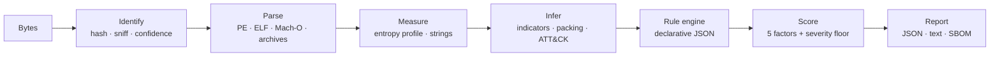

# Assay

Assay reads a compiled file (a binary, an installer, a package or a script) and reports what it is made of, what its imports let it do, which endpoints and strings it carries, and a risk score. Nothing is executed, nothing is extracted, nothing leaves the machine.

[](.github/workflows/ci.yml)
[](LICENSE)
[](Cargo.toml)

<sub>**English** · [简体中文](README.zh-CN.md)</sub>

## What it looks like

```bash
$ assay analyze suspicious.exe
suspicious.exe  [###########.........]
  pe x86 · 4.0 KiB · SHA-256 647e55903f2b5902
  High risk executable, score 55/100. Main contributors: offensive capability (35/35), packing / protection (9/28). Raised from the additive estimate of 52 because rule `pe-wx-section` matched at high severity.

Findings:
  [HIGH] pe-wx-section — Writable and executable section
        format is pe
        1 writable and executable section
  [MEDIUM] capability-injection — Process injection capability
        techniques matched: T1055
  [MEDIUM] capability-input-capture — Keystroke capture capability
        techniques matched: T1056.001
  [MEDIUM] high-entropy-code — Executable section is indistinguishable from ciphertext
        peak section entropy 7.91 meets the 7.60 threshold
  [LOW] pe-unsigned-with-network — No embedded signature, two or more endpoints
        format is pe
        no embedded signature (catalog signing is not checked)
        4 matching indicators (minimum 2)

ATT&CK:
  T1055 Process Injection (92%) — defense-evasion
  T1059.001 Command and Scripting Interpreter: PowerShell (88%) — execution
  T1056.001 Input Capture: Keylogging (74%) — credential-access

Indicators:
  url            http://185.220.101.42/beacon
  url            http://update-check.example-services.net/gate.php
  ipv4           185.220.101.42
  registry_key   HKEY_CURRENT_USER\Software\Microsoft\Windows\CurrentVersion\Run
  domain         update-check.example-services.net
  user_agent     Mozilla/5.0 (Windows NT 10.0; Win64; x64) AppleWebKit/537.36
```

## Install

Rust 1.82 or newer.

```bash
git clone https://github.com/nebula-eng/assay.git
cd assay
cargo install --path crates/assay-cli
```

The desktop workbench needs a front-end build first, because the Tauri shell embeds `ui/dist`. `cargo build -p assay-desktop` stops with an explicit message if you skip it.

```bash
npm --prefix ui install
npm --prefix ui run build
cargo build -p assay-desktop --release
```

Pre-built binaries for Windows, macOS and Linux are attached to each [release](https://github.com/nebula-eng/assay/releases).

## Use

```bash
assay analyze sample.exe                                    # one file, human-readable
assay analyze sample.exe --format json | jq .score.grade    # for a pipeline
assay batch ./dist --threshold high                         # fail the build on high or worse
assay sbom app.exe -o bom.json                              # CycloneDX
assay diff v1.2.0/app.exe v1.3.0/app.exe                    # what changed between builds
assay parse libfoo.so                                       # structure only, no scoring
```

Exit codes: `0` clean or low, `1` high, `2` critical, `3` usage error, I/O error, or partial analysis.

The Tauri shell calls `assay-core` directly, the same as the CLI, so the two cannot disagree. Drop files onto the window; the tabs are Overview, Structure, Imports, Strings, Indicators, ATT&CK and Findings.

## How the score is built

Five factors with fixed ceilings sum to 100. Each one reports the evidence that earned its points.

| Factor | Ceiling | Evidence |
|---|---|---|
| Offensive capability | 35 | ATT&CK techniques, weighted by confidence and position in the kill chain |
| Packing / protection | 28 | Signature and heuristic evidence from the packer detector |
| Code signing | 15 | Absent signature, broken digest algorithm, missing timestamp |
| Network indicators | 14 | URLs, routable addresses, onion services, wallet identifiers |
| Structural anomalies | 8 | W+X sections, overlapping ranges, checksum mismatch, overlays |

One factor cannot condemn a file on its own. The exception is the severity floor: when a rule matches an unambiguous attack shape, the score cannot fall below the band that finding implies, and the uplift appears as its own factor with a stated reason. A ransomware fixture with an additive estimate of 25 is reported as 75, because "low risk" for a complete extortion workflow would be misleading.

## Reading the imports

`CreateRemoteThread` on its own means nothing, since debuggers, profilers and game anti-cheat tools all call it. `VirtualAllocEx` together with `WriteProcessMemory` and `CreateRemoteThread` is process injection: allocate in another process, write code there, run it. Every rule in [`rules/builtin.json`](rules/builtin.json) encodes a combination like that, and a hit records which symbols satisfied which clause.

Two rules keep this from producing noise on ordinary system libraries:

- **Exports disqualify a symbol.** `advapi32.dll` exports `CryptEncrypt` and imports it from `CRYPTSP.dll`. That is API forwarding, not encryption.
- **A provider is not a user.** A module that both exports and imports two hundred or more symbols is infrastructure. Capability inference is skipped and the report says why. `kernel32.dll` scores 6/100; before this rule it scored 55/100 with process injection and rootkit inferred from the APIs it implements.

## False positives

A signature table is easy to write. The difficulty is not firing on the operating system.

The calibration corpus is every file in `C:\Windows\System32`, 4,386 of them, all signed or catalog-signed by Microsoft. Whatever the analyser says about them is either correct or a bug, with no judgement call to hide behind. The first run returned thirteen critical verdicts. Task Manager was a credential dumper because it lists `lsass.exe` in a process table. `certutil.exe` was a defence evader because it carries a certificate revocation endpoint. Eight Microsoft components were ransomware because they contained the word `payment`.

The current distribution is 3,796 clean, 389 low, 199 medium, 2 high, 0 critical. The two high findings are kept deliberately: the Settings app can genuinely turn off real-time protection, and the DPAPI server genuinely opens an LSA policy handle. `scripts/calibrate.py` reproduces the numbers on any Windows host, and fifteen binaries from that directory gate every push.

## Parsing

Every offset handed to the parser may be attacker-controlled, so the parsing layer is hand-written: PE, ELF, Mach-O, zip, tar, ar and gzip, roughly 4,900 lines. SHA-256, SHA-1, MD5, CRC32 and Base58Check are also written from the specifications and pinned by the published test vectors. The workspace is `#![forbid(unsafe_code)]` and has five runtime dependencies: `serde`, `serde_json`, `thiserror`, `regex-lite`, `rayon`.

All reads go through one bounded reader that cannot index out of bounds and reports the absolute file offset of every failure. Every loop over an attacker-controlled count carries a named limit. A fuzz test feeds thousands of malformed buffers and asserts that each one produces a report rather than a panic.

Archives are enumerated from the central directory, meaning names, declared sizes and compression ratios, and never decompressed. A 100:1 declared ratio is reported as a finding, not acted on.

| Layer | Coverage |
|---|---|
| **PE** | DOS stub, NT headers, sections, imports, delay-load imports, exports including forwarders, resource tree, debug directory (PDB path and GUID), TLS callbacks, Rich header, CLR header, Authenticode blob, checksum verification |
| **ELF** | 32/64-bit, both endians, section and program headers, `.dynamic` (`DT_NEEDED`, `SONAME`, `RPATH`, `RUNPATH`, `BIND_NOW`), symbol tables, `.note.gnu.build-id`, `.comment`, NX/RELRO/PIE posture |
| **Mach-O** | Thin and fat, load commands, segments and sections, dylibs, `LC_UUID`, `LC_BUILD_VERSION`, `LC_CODE_SIGNATURE` presence, per-slice inventory |
| **Archives** | zip family (`.jar`, `.apk`, `.whl`, `.nupkg`, `.vsix`, `.epub`, OOXML) including Zip64; `ar` (`.a`, `.lib`, `.deb`); tar (ustar/GNU/pax); gzip |
| **Scripts** | Shebang dispatch, UTF-16 PowerShell detection, obfuscation markers |

Full matrix and known blind spots: [`docs/FORMATS.md`](docs/FORMATS.md).

## Pipeline



Identification runs before parsing because nothing downstream is usable if the container is wrong. Scoring runs after rules because rules that match on `min_score` need the final number. A parse failure becomes a diagnostic and the pipeline continues with whatever was recovered.

Details: [`docs/ARCHITECTURE.md`](docs/ARCHITECTURE.md).

## Limits

- **No execution or emulation.** No sandbox, no CPU emulation, no API hooking.
- **No decompression.** Archive enumeration stops at the container tables.
- **No signature verification.** It reports which digest algorithm a signature names, whether a countersignature exists, and which identity the certificate claims. Establishing trust needs the platform verifier and a trust store.
- **No disassembly.** Capability comes from the import surface and string evidence, which is weaker than full analysis.
- **No GeoIP, ASN lookup or reputation.** Offline by construction, so the same bytes and the same rules give the same report on an air-gapped host.
- **No .NET metadata tables, no DWARF, no relocations.** Those belong to a managed assembly reader, a debugger and a loader.

## Rules

Rules are JSON and do not need a recompile.

```json
{
  "id": "corp-unsigned-delivery",
  "name": "Unsigned PE that talks to the network",
  "severity": "high",
  "description": "Delivery-stage binaries in our estate are always signed.",
  "match": {
    "format": ["pe"],
    "signed": false,
    "min_iocs": 1,
    "ioc_kinds": ["url", "ipv4"]
  },
  "tags": ["delivery"]
}
```

```bash
assay analyze sample.exe --rules corp.json
assay rules validate corp.json
assay rules list
```

Clauses inside `match` are conjunctive; an omitted clause imposes nothing. Available: `format`, `kind`, `signed`, `min_iocs`, `ioc_kinds`, `min_packer`, `min_score`, `any_imports`, `all_imports`, `max_imports`, `any_strings`, `techniques`, `has_tls`, `is_dotnet`, `min_entropy`, `min_wx_sections`, `min_executable_entries`, `relro`, `loader_paths`.

An unknown clause is a parse error. Silently ignoring it would let a typo widen the rule until it matched everything.

Grammar: [`docs/RULES.md`](docs/RULES.md).

## Performance

Release build, Windows 11, Intel Core Ultra 5 125H, single threaded, best of three runs.

| Artefact | Size | Total | Analysis | Throughput |
|---|---|---|---|---|
| Small PE | 2 KiB | 177 ms | ~7 ms | — |
| Typical library | 7.7 MB | 1.4 s | 1.2 s | 6.4 MB/s |
| Large installer | 86 MB | 7.8 s | 7.6 s | 11.3 MB/s |
| Framework binary | 227 MB | 18 s | 17.7 s | 12.9 MB/s |

Process start costs about 170 ms, so analysing a small file is dominated by launching the binary. For a directory use `assay batch` rather than one process per file.

Steady-state throughput is around 12 MB/s because a byte is read eight times before the report is finished: four digests in the identify stage (SHA-256, SHA-1, MD5, fuzzy hash, where the fuzzy hash rescans when the block size is halved), one pass for windowed entropy, and three string scans for ASCII, UTF-16LE and UTF-16BE. On an 86 MB file the digests take 18% of wall time, parsing 17%, string recovery 5%, and entropy plus indicator extraction the remaining 60%.

Peak working set is file size plus a bounded constant: 463 MB for a 227 MB input, which puts the default 512 MB `--max-size-mb` near a 1 GB ceiling.

## Documentation

| Document | Contents |
|---|---|
| [`docs/ARCHITECTURE.md`](docs/ARCHITECTURE.md) | Stage ordering, invariants, the bounded reader, threading, score design |
| [`docs/FORMATS.md`](docs/FORMATS.md) | Per-format support matrix and blind spots |
| [`docs/SCORING.md`](docs/SCORING.md) | Weight calibration, the severity floor, worked examples |
| [`docs/RULES.md`](docs/RULES.md) | Rule grammar and the built-in corpus |
| [`docs/CLI.md`](docs/CLI.md) | Commands, flags, exit codes, output schema |
| [`docs/THREAT-MODEL.md`](docs/THREAT-MODEL.md) | What this defends against and what it does not |
| [`CHANGELOG.md`](CHANGELOG.md) | Version history |

## Development

```bash
cargo test                                  # 198 unit tests + 1 doc test
cargo clippy --workspace --all-targets -- -D warnings
cargo fmt --all -- --check

python tests/e2e.py --samples samples       # 25 CLI assertions
npm --prefix ui run build                   # typecheck and bundle

# The interface is checked in a browser engine, not by the bundler.
# In another terminal: make serve
node scripts/ui_smoke.mjs     --url http://127.0.0.1:8801/
node scripts/ui_shots.mjs     --url http://127.0.0.1:8801/   # 28 screenshots, geometry
node scripts/design_audit.mjs --url http://127.0.0.1:8801/   # contrast, type, rhythm

python scripts/linkcheck.py                 # relative links and heading anchors
python scripts/calibrate.py                 # false-positive distribution, Windows only
```

`make ui-verify` runs the three interface checks against a served bundle and fails if nothing is listening.

`make samples` rebuilds the fixture corpus, which is not committed. A detector regression then shows up as a diff you can read instead of a binary you cannot.

`make icons` rebuilds the application icon set, which is committed: `tauri-build` embeds `icon.ico` into the Windows resource table at compile time, so a fresh clone has to be able to build the desktop crate without a Python step.

[`CONTRIBUTING.md`](CONTRIBUTING.md) lists the invariants a pull request must not break.

## Legal

Use it on files you own or are authorised to examine, and follow your local law. The tool reads bytes and reports what it finds.

## License

MIT, see [`LICENSE`](LICENSE). Report security issues through [`SECURITY.md`](SECURITY.md) rather than a public issue.
