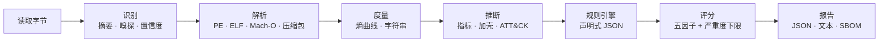

# Assay · 试金

Assay 读取编译产物（二进制、安装包、压缩包或脚本），报告它由什么构成、它的导入表允许它做什么、里面带了哪些地址和字符串，以及一个风险评分。它不执行文件、不解压文件，也不联网。

[](.github/workflows/ci.yml)
[](LICENSE)
[](Cargo.toml)

<sub>[English](README.md) · **简体中文**</sub>

## 输出示例

```bash
$ assay analyze suspicious.exe
suspicious.exe  [###########.........]
  pe x86 · 4.0 KiB · SHA-256 647e55903f2b5902
  High risk executable, score 55/100. Main contributors: offensive capability (35/35), packing / protection (9/28). Raised from the additive estimate of 52 because rule `pe-wx-section` matched at high severity.

Findings:
  [HIGH] pe-wx-section — Writable and executable section
        format is pe
        1 writable and executable section
  [MEDIUM] capability-injection — Process injection capability
        techniques matched: T1055
  [MEDIUM] capability-input-capture — Keystroke capture capability
        techniques matched: T1056.001
  [MEDIUM] high-entropy-code — Executable section is indistinguishable from ciphertext
        peak section entropy 7.91 meets the 7.60 threshold
  [LOW] pe-unsigned-with-network — No embedded signature, two or more endpoints
        format is pe
        no embedded signature (catalog signing is not checked)
        4 matching indicators (minimum 2)

ATT&CK:
  T1055 Process Injection (92%) — defense-evasion
  T1059.001 Command and Scripting Interpreter: PowerShell (88%) — execution
  T1056.001 Input Capture: Keylogging (74%) — credential-access

Indicators:
  url            http://185.220.101.42/beacon
  url            http://update-check.example-services.net/gate.php
  ipv4           185.220.101.42
  registry_key   HKEY_CURRENT_USER\Software\Microsoft\Windows\CurrentVersion\Run
  domain         update-check.example-services.net
  user_agent     Mozilla/5.0 (Windows NT 10.0; Win64; x64) AppleWebKit/537.36
```

## 安装

需要 Rust 1.82 或更新版本。

```bash
git clone https://github.com/nebula-eng/assay.git
cd assay
cargo install --path crates/assay-cli
```

桌面工作台要先构建前端，因为 Tauri 外壳会把 `ui/dist` 打进二进制。跳过这一步，`cargo build -p assay-desktop` 会停下并说明原因。

```bash
npm --prefix ui install
npm --prefix ui run build
cargo build -p assay-desktop --release
```

Windows、macOS、Linux 的预编译包附在每个 [release](https://github.com/nebula-eng/assay/releases) 里。

## 用法

```bash
assay analyze sample.exe                                    # 单文件，人读格式
assay analyze sample.exe --format json | jq .score.grade    # 接流水线
assay batch ./dist --threshold high                         # 达到 high 就让构建失败
assay sbom app.exe -o bom.json                              # 输出 CycloneDX
assay diff v1.2.0/app.exe v1.3.0/app.exe                    # 两次构建之间变了什么
assay parse libfoo.so                                       # 只看结构，不打分
```

退出码：`0` clean 或 low，`1` high，`2` critical，`3` 用法错误、I/O 错误或分析不完整。

Tauri 外壳直接调 `assay-core`，和命令行是同一条路径，所以两边结论不会打架。文件拖进窗口即可；页签是概览、结构、导入、字符串、指标、ATT&CK、发现。

## 评分怎么算

五个因子，各自有上限，加起来是 100。每个因子都会报出它凭什么拿到这些分。

| 因子 | 上限 | 依据 |
|---|---|---|
| 攻击能力 | 35 | ATT&CK 技术，按置信度和在杀伤链中的位置加权 |
| 加壳 / 保护 | 28 | 加壳检测器的签名与启发式证据 |
| 代码签名 | 15 | 无签名、摘要算法已破、缺少时间戳 |
| 网络指标 | 14 | URL、可路由地址、洋葱服务、钱包标识 |
| 结构异常 | 8 | 可写可执行节、区间重叠、校验和不符、附加数据 |

单个因子定不了罪。例外是严重度下限：某条规则命中了没有歧义的攻击形态时，分数不会低于该发现对应的等级，提升量单独记为一个因子并写明原因。一个加成估算只有 25 的勒索样本会报成 75，因为把一个完整的勒索流程标成"低风险"是误导。

## 导入表怎么读

单独一个 `CreateRemoteThread` 说明不了什么，调试器、性能分析器、游戏反作弊都会调它。`VirtualAllocEx` 加上 `WriteProcessMemory` 再加上 `CreateRemoteThread` 是进程注入：在别的进程里分配内存、写入代码、执行。[`rules/builtin.json`](rules/builtin.json) 里每条规则都编码了这样一个组合，命中时会记录是哪几个符号满足了哪条子句。

两条约束防止它在普通系统库上刷出一堆噪音：

- **自己导出的符号不算自己使用的能力。** `advapi32.dll` 导出 `CryptEncrypt`，又从 `CRYPTSP.dll` 导入它，那是 API 转发，不是加密。
- **提供者不是使用者。** 一个模块如果导出和导入都在两百个以上，它是基础设施。此类模块跳过能力推断并在报告里说明原因。`kernel32.dll` 得 6 分；这条规则之前它得 55 分，从它自己实现的 API 里推断出了进程注入和 rootkit。

## 误报

签名表好写。难的是不在操作系统自己的文件上误报。

标定集是 `C:\Windows\System32` 全目录，4386 个文件，全部由微软签名或目录签名。分析器对它们说的任何话，要么是对的，要么是 bug，没有"见仁见智"的余地。第一次跑出十三个 critical：任务管理器因为进程列表里出现 `lsass.exe` 被判成凭据窃取；`certutil.exe` 因为带着证书吊销列表的域名被判成对抗防御；八个微软组件因为字符串里有 `payment` 被判成勒索软件。

当前分布是 3796 clean、389 low、199 medium、2 high、0 critical。两个 high 是特意留下的：设置应用确实能关闭实时保护，DPAPI 服务确实会打开 LSA 策略句柄。`scripts/calibrate.py` 可以在任何 Windows 主机上复现这组数字，每次推送都会跑其中十五个文件。

## 解析层

交给解析器的每个偏移量都可能由攻击者决定，所以解析层是手写的：PE、ELF、Mach-O、zip、tar、ar、gzip，约 4900 行。SHA-256、SHA-1、MD5、CRC32、Base58Check 也是按规范实现，并用公开测试向量固定住。整个工作区 `#![forbid(unsafe_code)]`，运行时依赖五个：`serde`、`serde_json`、`thiserror`、`regex-lite`、`rayon`。

所有读取都走同一个有界读取器，它不可能越界，每次失败都会报出文件的绝对偏移。每一个遍历攻击者可控数量的循环旁边都写着一个具名上限。模糊测试会灌入数千个畸形缓冲区，断言每一个都能产出报告而不是 panic。

压缩包只读中央目录，也就是成员名、声明大小和压缩比，从不调用解压器。声明压缩比 100:1 会被记为发现，而不是被执行。

| 层 | 覆盖范围 |
|---|---|
| **PE** | DOS 头、NT 头、节表、导入、延迟导入、导出（含转发）、资源树、调试目录（PDB 路径与 GUID）、TLS 回调、Rich 头、CLR 头、Authenticode 签名块、校验和验证 |
| **ELF** | 32/64 位、两种字节序、节头与程序头、`.dynamic`（`DT_NEEDED`、`SONAME`、`RPATH`、`RUNPATH`、`BIND_NOW`）、符号表、`.note.gnu.build-id`、`.comment`、NX/RELRO/PIE 状态 |
| **Mach-O** | 单架构与 fat、加载命令、段与节、dylib、`LC_UUID`、`LC_BUILD_VERSION`、`LC_CODE_SIGNATURE` 是否存在、逐架构清单 |
| **压缩包** | zip 家族（`.jar`、`.apk`、`.whl`、`.nupkg`、`.vsix`、`.epub`、OOXML）含 Zip64；`ar`（`.a`、`.lib`、`.deb`）；tar（ustar/GNU/pax）；gzip |
| **脚本** | Shebang 分派、UTF-16 PowerShell 识别、混淆标记扫描 |

完整矩阵与已知盲区：[`docs/FORMATS.md`](docs/FORMATS.md)。

## 流水线



识别在解析之前，容器判断错了后面全是错的。评分在规则之后，因为按 `min_score` 匹配的规则要拿到最终分数。解析失败会记成一条诊断，流水线带着已恢复的部分继续。

细节：[`docs/ARCHITECTURE.md`](docs/ARCHITECTURE.md)。

## 边界

- **不执行、不模拟。** 没有沙箱、没有 CPU 模拟、没有 API Hook。
- **不解压。** 压缩包只读到容器表为止。
- **不验证签名。** 它会报告签名用了哪种摘要算法、有没有副署、证书声称的签发者是谁。确认信任需要平台验证器和信任库。
- **不反汇编。** 能力判断来自导入表和字符串证据，比完整分析弱。
- **不做 GeoIP、ASN 查询、信誉查询。** 从设计上离线，所以同样的字节加同样的规则，在断网机器上给出同样的报告。
- **不解析 .NET 元数据表、不解析 DWARF、不应用重定位。** 那分别属于托管程序读取器、调试器和加载器。

## 规则

规则是 JSON，改规则不用重新编译。

```json
{
  "id": "corp-unsigned-delivery",
  "name": "Unsigned PE that talks to the network",
  "severity": "high",
  "description": "Delivery-stage binaries in our estate are always signed.",
  "match": {
    "format": ["pe"],
    "signed": false,
    "min_iocs": 1,
    "ioc_kinds": ["url", "ipv4"]
  },
  "tags": ["delivery"]
}
```

```bash
assay analyze sample.exe --rules corp.json
assay rules validate corp.json
assay rules list
```

`match` 里的子句是"与"关系，不写的子句不施加任何约束。可用子句：`format`、`kind`、`signed`、`min_iocs`、`ioc_kinds`、`min_packer`、`min_score`、`any_imports`、`all_imports`、`max_imports`、`any_strings`、`techniques`、`has_tls`、`is_dotnet`、`min_entropy`、`min_wx_sections`、`min_executable_entries`、`relro`、`loader_paths`。

子句名拼错会报解析错误。静默忽略的话，一个笔误就能把规则放宽到匹配所有文件。

语法：[`docs/RULES.md`](docs/RULES.md)。

## 性能

Release 构建，Windows 11，Intel Core Ultra 5 125H，单线程，三次取最快。

| 文件 | 大小 | 总耗时 | 分析耗时 | 吞吐 |
|---|---|---|---|---|
| 小 PE | 2 KiB | 177 ms | ~7 ms | — |
| 常规库 | 7.7 MB | 1.4 s | 1.2 s | 6.4 MB/s |
| 大型安装包 | 86 MB | 7.8 s | 7.6 s | 11.3 MB/s |
| 框架二进制 | 227 MB | 18 s | 17.7 s | 12.9 MB/s |

进程启动本身约 170 ms，所以分析小文件的耗时主要是拉起进程。批量扫描目录请用 `assay batch`，不要一个文件起一个进程。

稳定吞吐约 12 MB/s，因为出报告之前一个字节要被读八遍：识别阶段四个摘要（SHA-256、SHA-1、MD5、模糊哈希，其中模糊哈希在块大小减半时会重扫），熵曲线一遍，字符串三遍（ASCII、UTF-16LE、UTF-16BE）。在 86 MB 文件上，摘要占实际耗时 18%，解析 17%，字符串恢复 5%，剩下 60% 是熵与指标提取。

峰值内存是文件大小加一个有界常数：227 MB 的输入占用 463 MB，所以默认的 `--max-size-mb 512` 大致对应 1 GB 上限。

## 文档

| 文档 | 内容 |
|---|---|
| [`docs/ARCHITECTURE.md`](docs/ARCHITECTURE.md) | 阶段顺序、不变量、有界读取器、线程模型、评分设计 |
| [`docs/FORMATS.md`](docs/FORMATS.md) | 各格式支持矩阵与盲区 |
| [`docs/SCORING.md`](docs/SCORING.md) | 权重标定、严重度下限、算例 |
| [`docs/RULES.md`](docs/RULES.md) | 规则语法与内置规则集 |
| [`docs/CLI.md`](docs/CLI.md) | 命令、参数、退出码、输出结构 |
| [`docs/THREAT-MODEL.md`](docs/THREAT-MODEL.md) | 防什么、不防什么 |
| [`CHANGELOG.md`](CHANGELOG.md) | 版本记录 |

## 开发

```bash
cargo test                                  # 198 项单元测试 + 1 项文档测试
cargo clippy --workspace --all-targets -- -D warnings
cargo fmt --all -- --check

python tests/e2e.py --samples samples       # 25 条 CLI 断言
npm --prefix ui run build                   # 类型检查 + 打包

# 界面在浏览器引擎里验，不靠打包器。
# 另开一个终端：make serve
node scripts/ui_smoke.mjs     --url http://127.0.0.1:8801/
node scripts/ui_shots.mjs     --url http://127.0.0.1:8801/   # 28 张截图，量几何
node scripts/design_audit.mjs --url http://127.0.0.1:8801/   # 对比度、字号、节奏

python scripts/linkcheck.py                 # 相对链接与标题锚点
python scripts/calibrate.py                 # 误报分布，需 Windows
```

`make ui-verify` 会把三项界面检查跑一遍，没有服务在监听时直接失败。

`make samples` 重建样本集，样本不进仓库。检测器出现回归时，你看到的是可读的 diff，而不是一个不知道改了什么的神秘二进制。

`make icons` 重建图标集，图标进仓库：`tauri-build` 会在编译期把 `icon.ico` 嵌入 Windows 资源表，所以刚克隆的仓库必须能在不跑 Python 的情况下构建桌面端。

提交前要守的不变量写在 [`CONTRIBUTING.md`](CONTRIBUTING.md)。

## 合法使用

只分析你拥有或获授权检查的文件，并遵守当地法律。工具只读字节。

## 许可

MIT，见 [`LICENSE`](LICENSE)。安全问题请走 [`SECURITY.md`](SECURITY.md)，不要开公开 issue。
